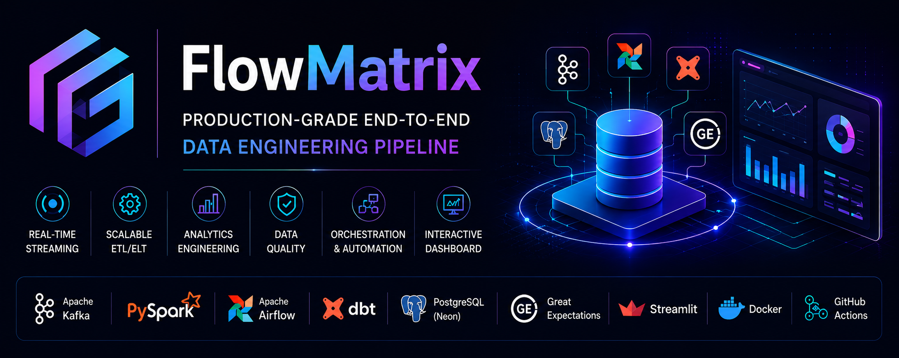
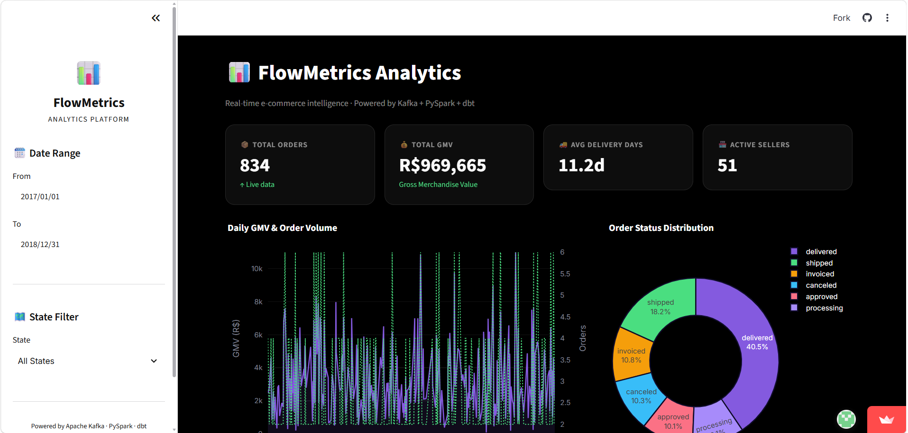
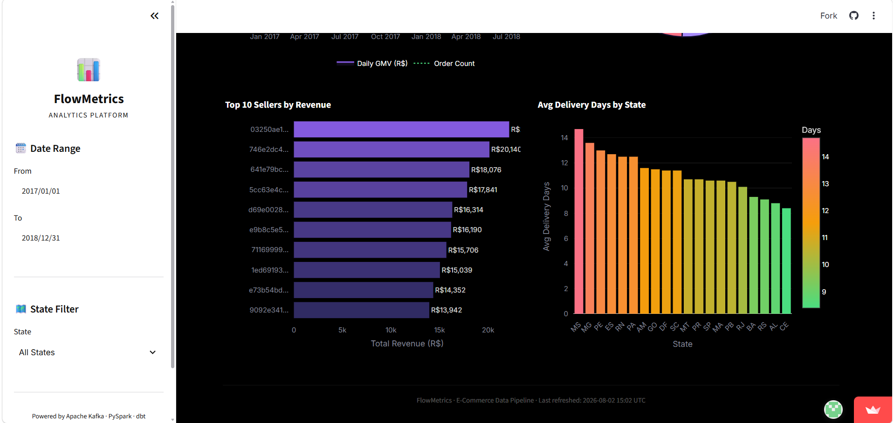
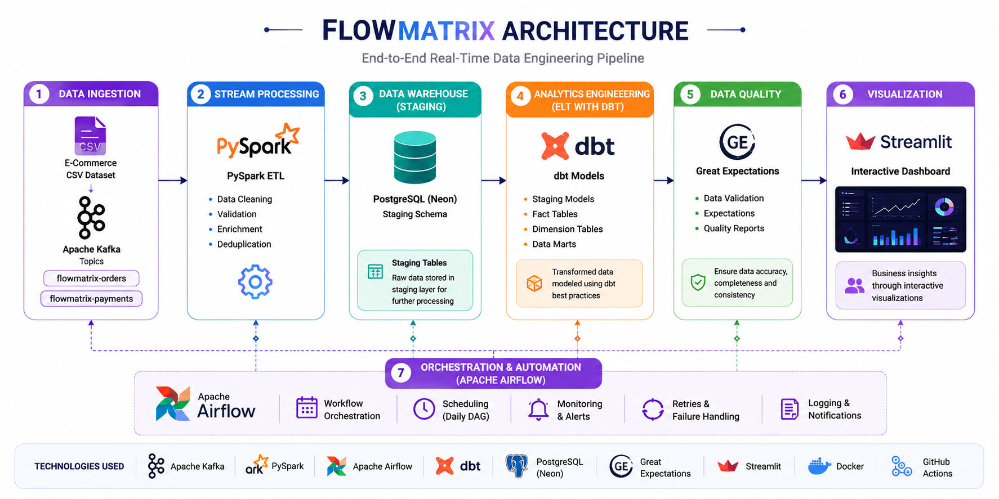

# ⚡ FlowMatrix

### Production-Grade End-to-End Real-Time Data Engineering Pipeline



FlowMatrix is a production-grade end-to-end data engineering platform that simulates a real-world e-commerce analytics system using modern data engineering technologies and industry best practices.

It demonstrates real-time data ingestion, scalable ETL/ELT pipelines, analytics engineering, workflow orchestration, data quality validation, cloud analytics, and CI/CD automation.

---

## 🚀 Features

- 📥 Real-Time Data Streaming with Apache Kafka
- ⚡ Distributed ETL using PySpark
- 🗄️ Analytics Engineering with dbt
- 🎯 Workflow Orchestration using Apache Airflow
- ✅ Data Quality Validation with Great Expectations
- 📊 Interactive Analytics Dashboard using Streamlit
- 🐳 Dockerized Deployment
- 🔄 GitHub Actions CI/CD
- ☁️ Cloud PostgreSQL (Neon)

---

## 📸 Dashboard Preview

### Business Dashboard



### Analytics Dashboard



---

## 🏗️ Architecture



---

# 📊 Project Highlights

| Metric | Value |
|---------|------:|
| Orders Processed | 100,342+ |
| Data Pipeline | Real-Time |
| ETL Engine | PySpark |
| Workflow | Apache Airflow |
| Dashboard | Streamlit |
| Database | PostgreSQL |
| Data Quality | Great Expectations |

---

# 🛠️ Tech Stack

| Category | Technologies |
|----------|--------------|
| Programming | Python, SQL |
| Streaming | Apache Kafka |
| Processing | PySpark |
| Workflow | Apache Airflow |
| Analytics Engineering | dbt |
| Database | PostgreSQL (Neon) |
| Data Quality | Great Expectations |
| Dashboard | Streamlit |
| Containers | Docker |
| CI/CD | GitHub Actions |

---

# 🔄 Data Pipeline

```text
CSV Dataset
      │
      ▼
Apache Kafka
      │
      ▼
PySpark ETL
      │
      ▼
PostgreSQL (Staging)
      │
      ▼
dbt Models
      │
      ▼
Fact & Dimension Tables
      │
      ▼
Great Expectations
      │
      ▼
Streamlit Dashboard
```

---

# 📂 Project Structure

```
flowmatrix-pipeline/
│
├── airflow/
├── dashboard/
├── data/
├── dbt_project/
├── docker/
├── ingestion/
├── processing/
├── quality/
├── tests/
├── .github/
├── docker-compose.yml
├── Makefile
└── README.md
```

---

# ⚡ Quick Start

```bash
git clone https://github.com/yourusername/flowmatrix-pipeline.git

cd flowmatrix-pipeline

make init

make up

make run

make dbt-run

make dashboard
```

---

# 🌟 Key Learnings

- Building scalable ETL pipelines
- Event-driven architecture with Kafka
- Analytics Engineering using dbt
- Workflow orchestration with Airflow
- Data quality automation
- Dashboard development
- Dockerized deployments
- CI/CD automation

---

# 🚀 Future Enhancements

- AWS Deployment
- Apache Spark Streaming
- Kubernetes
- Terraform
- Prometheus & Grafana
- Data Lineage
- Lakehouse Architecture
- Snowflake Support

---

# 📄 License

MIT License

---

<div align="center">

### ⭐ If you found this project useful, consider giving it a star!

**FlowMatrix — Production-Grade Data Engineering Pipeline**

</div>
